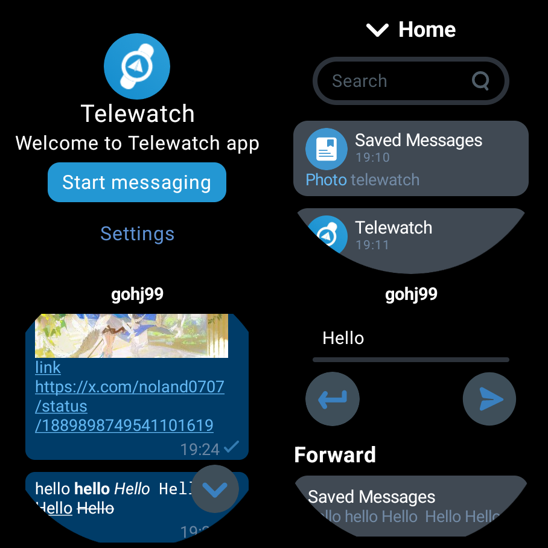

<a href="https://github.com/1ZSQ2waz/Telewatch">

</a>

<div align="center">
  <br/>
  <div>
      繁體中文 | <a href="./README.md">English</a> | <a href="./README.zh-CN.md">简体中文</a> | <a href="./README.ja-JP.md">日本語</a>
  </div>
  <br/>

<div>
    <a href="https://github.com/1ZSQ2waz/Telewatch/blob/main/LICENSE">
      
    </a >
    <a href="https://github.com/1ZSQ2waz/Telewatch/releases">
        
    </a >
    <a href="https://apt.izzysoft.de/fdroid/index/apk/com.gohj99.telewatch">
        
    </a >
  </div>
</div>



## 継続メンテナンス

このリポジトリはアーカイブされた
[gohj99/Telewatch](https://github.com/gohj99/Telewatch) の開発を継続します。
上流の著作権、移植元、ライセンス情報は
[FORK_NOTICE.md](FORK_NOTICE.md) を参照してください。

## ダウンロード

ダウンロード: [Telewatch](https://github.com/1ZSQ2waz/Telewatch/releases)
ADB シェル:

1. リリースから Telewatch をダウンロードする
2. インストール:

```shell
adb install Telewatch.apk
```

## 関数

- FCM メッセージ通知、クイックビュー、既読マーク、返信
- 複数アカウント対応
- インターフェースのカスタマイズ
- 完全なメッセージグループ化のサポート
- 未読/既読インジケーター
- 接続状態インジケーター
- テキスト、画像、ビデオの閲覧またはダウンロード
- 音声メッセージを再生
- メッセージの返信と転送
- 画像やビデオの保存
- テキスト送信
- メッセージ削除
- クラウンローテーションのサポート

## 最小構成と推奨構成

- 最小メモリ (RAM): 1G
- 最小ストレージ容量 (ROM): 8G
- 最小互換性システム: Android 7.0 (API レベル 24 Nougat)
- 推奨メモリ (RAM): 2G
- 推奨ストレージ容量（ROM）：16G
- 推奨システム: Android 11 (API レベル 30 R) または Wear OS 3.0 (API レベル 30)

＃＃ コミュニティ

フィードバックを提供するには、[issue](https://github.com/1ZSQ2waz/Telewatch/issues) を使用することをお勧めします。
もちろん、次のようなフィードバック方法も可能です。

- [テレグラム](https://t.me/teleAndroidwatch)

## Star History

<a href="https://star-history.com/#1ZSQ2waz/Telewatch&Date">
 <picture>
   <source media="(prefers-color-scheme: dark)" srcset="https://api.star-history.com/svg?repos=1ZSQ2waz/Telewatch&type=Date&theme=dark" />
   <source media="(prefers-color-scheme: light)" srcset="https://api.star-history.com/svg?repos=1ZSQ2waz/Telewatch&type=Date" />
   
 </picture>
</a>
