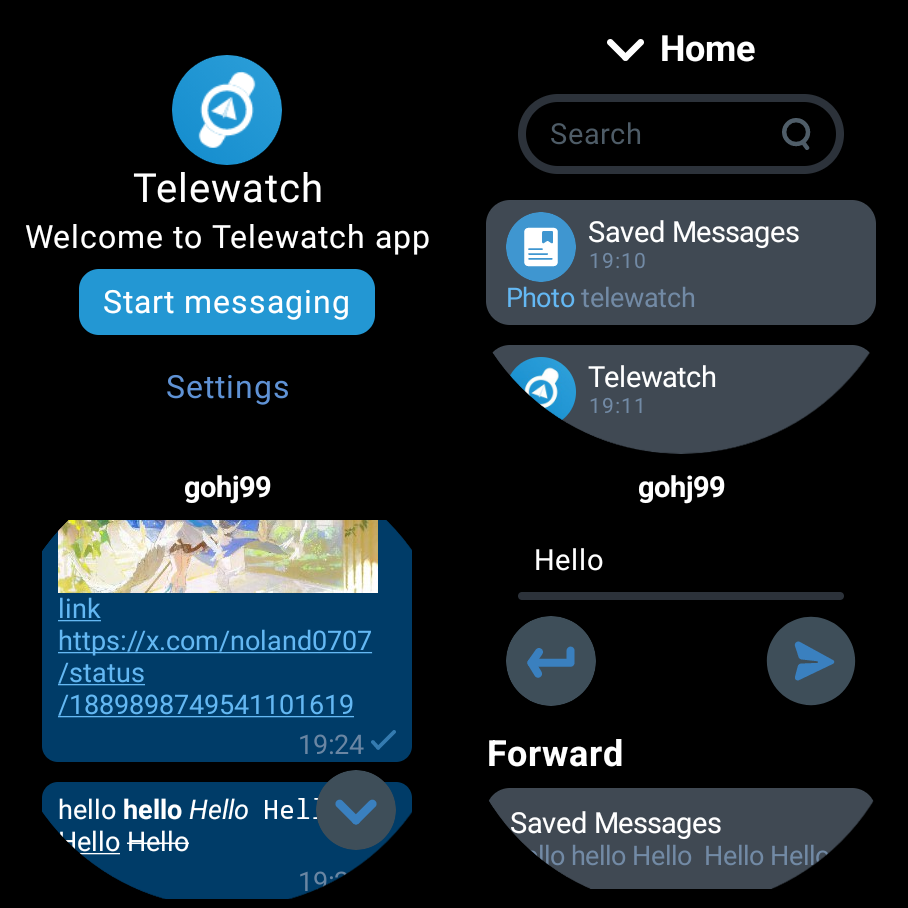

<a href="https://github.com/1ZSQ2waz/Telewatch">

</a>

<div align="center">
  <br/>
  <div>
      English | <a href="./README.zh-CN.md">简体中文</a> | <a href="./README.zh-TW.md">繁體中文</a> | <a href="./README.ja-JP.md">日本語</a>
  </div>
  <br/>

<div>
    <a href="https://github.com/1ZSQ2waz/Telewatch/blob/main/LICENSE">
      
    </a >
    <a href="https://github.com/1ZSQ2waz/Telewatch/releases">
        
    </a >
    <a href="https://apt.izzysoft.de/fdroid/index/apk/com.gohj99.telewatch">
        
    </a >
    <a href="https://github.com/MShawon/github-clone-count-badge">
        
    </a >
  </div>
</div>



## Maintained fork

This repository continues the archived
[gohj99/Telewatch](https://github.com/gohj99/Telewatch) project. See
[FORK_NOTICE.md](FORK_NOTICE.md) for upstream attribution and licensing.

## Download

Download: [Telewatch](https://github.com/1ZSQ2waz/Telewatch/releases)
ADB Shell:

1. Download Telewatch for releases
2. Install:

```shell
adb install Telewatch.apk
```

## Functions

- FCM message notification, quick viewing, marking as read and replying
- Multi-account support
- Interface customization
- All message grouping support
- Unread/read indicator
- Connection status indicator
- Viewing or downloading text, images, and videos
- Play Voice Message
- Reply and forward messages
- Saving images or videos
- Text messaging
- Message deletion
- Support for rotating the digital crown
- Sticker packs, sticker sending, and Unicode emoji input
- Reading-position restoration and smoother rotary scrolling
- Faster thumbnail scheduling and progressive photo loading
- Built-in NiagramX Cloudflare Worker proxy with regional fallback

## Building

Copy `app/src/main/assets/config.properties.example` to
`app/src/main/assets/config.properties`, replace the Telegram API placeholders,
and run:

```shell
./gradlew assembleArmDebug assembleArm64Debug
```

## Minimum and recommended requirements

- Minimum RAM: 1G
- Minimum ROM: 8G
- Minimum System: Android 7.0 (API Level 24 Nougat)
- Recommended RAM: 2G
- Recommended ROM: 16G
- Recommended System: Android 11 (API Level 30 R) or Wear OS 3.0 (API level 30)

## Community

We recommend using [issue](https://github.com/1ZSQ2waz/Telewatch/issues) to provide the most direct
and effective feedback. Of course, the following options for feedback are also available:

- [Telegram](https://t.me/teleAndroidwatch)

## Star History

<a href="https://star-history.com/#1ZSQ2waz/Telewatch&Date">
 <picture>
   <source media="(prefers-color-scheme: dark)" srcset="https://api.star-history.com/svg?repos=1ZSQ2waz/Telewatch&type=Date&theme=dark" />
   <source media="(prefers-color-scheme: light)" srcset="https://api.star-history.com/svg?repos=1ZSQ2waz/Telewatch&type=Date" />
   
 </picture>
</a>
