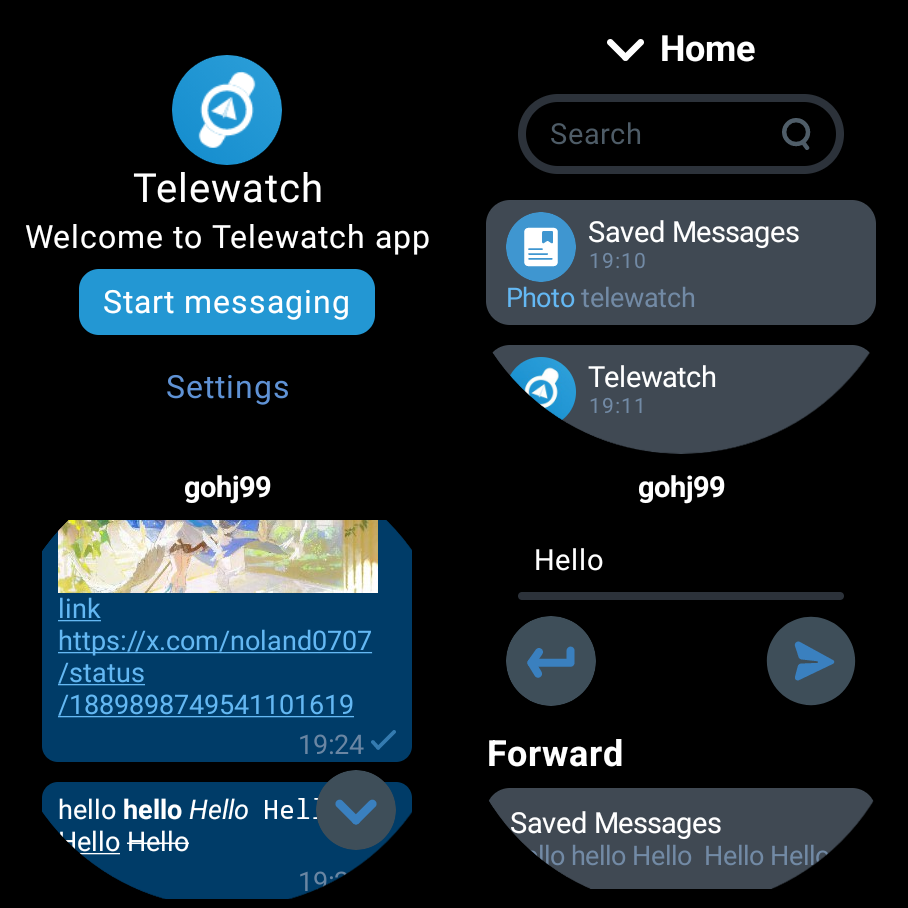

<a href="https://github.com/1ZSQ2waz/Telewatch">

</a>

<div align="center">
  <br/>
  <div>
      简体中文 | <a href="./README.md">English</a> | <a href="./README.zh-TW.md">繁體中文</a> | <a href="./README.ja-JP.md">日本語</a>
  </div>
  <br/>

<div>
    <a href="https://github.com/1ZSQ2waz/Telewatch/blob/main/LICENSE">
      
    </a >
    <a href="https://github.com/1ZSQ2waz/Telewatch/releases">
        
    </a >
    <a href="https://apt.izzysoft.de/fdroid/index/apk/com.gohj99.telewatch">
        
    </a >
	<a href="https://github.com/MShawon/github-clone-count-badge">
        
    </a >
  </div>
</div>



## 持续维护分支

本仓库延续已归档的 [gohj99/Telewatch](https://github.com/gohj99/Telewatch)
项目。上游著作权、移植来源和许可证说明见
[FORK_NOTICE.md](FORK_NOTICE.md)。

## 下载

下载: [Telewatch](https://github.com/1ZSQ2waz/Telewatch/releases)
ADB Shell:

1. 从releases下载Telewatch
2. 安装:

```shell
adb install Telewatch.apk
```

## 功能

- FCM消息通知，快捷查看、标记已读与回复
- 多账号支持
- 界面自定义
- 全部消息分组支持
- 未读/已读指示器
- 连接状态指示器
- 文字、图片、视频查看或下载
- 回复与转发消息
- 播放语音消息
- 保存图片或视频
- 文字发送
- 删除消息
- 支持表冠旋转
- 贴纸包浏览、贴纸发送与 Unicode emoji 输入
- 聊天阅读位置恢复与更平滑的表冠滚动
- 更快的缩略图调度与渐进式大图加载
- 内置 NiagramX Cloudflare Worker 代理与地区线路回退

## 编译

将 `app/src/main/assets/config.properties.example` 复制为
`app/src/main/assets/config.properties`，填入自己的 Telegram API 配置，然后运行：

```shell
./gradlew assembleArmDebug assembleArm64Debug
```

## 最低配置和推荐配置

- 最低内存(RAM): 1G
- 最低存储空间(ROM): 8G
- 最低兼容的系统: Android 7.0 (API Level 24 Nougat)
- 推荐内存(RAM): 2G
- 推荐存储空间(ROM): 16G
- 推荐的系统: Android 11 (API Level 30 R) or Wear OS 3.0 (API level 30)

## 反馈

推荐使用[issue](https://github.com/1ZSQ2waz/Telewatch/issues)来反馈。
当然，以下反馈方式也是可行的：

- [Telegram](https://t.me/teleAndroidwatch)

## Star History

<a href="https://star-history.com/#1ZSQ2waz/Telewatch&Date">
 <picture>
   <source media="(prefers-color-scheme: dark)" srcset="https://api.star-history.com/svg?repos=1ZSQ2waz/Telewatch&type=Date&theme=dark" />
   <source media="(prefers-color-scheme: light)" srcset="https://api.star-history.com/svg?repos=1ZSQ2waz/Telewatch&type=Date" />
   
 </picture>
</a>
